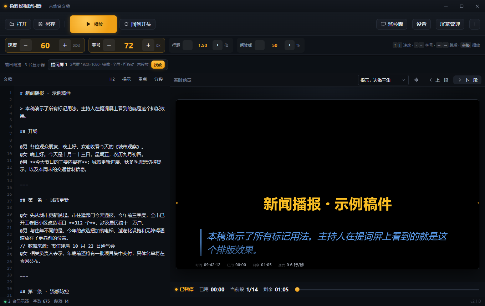
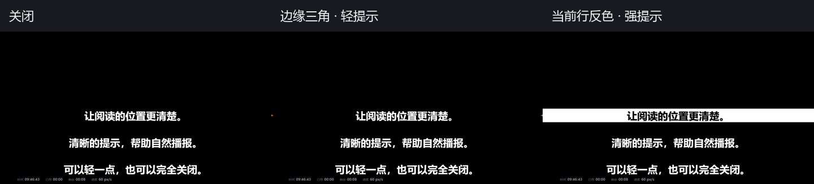

# 鲁科影视提词器（Windows）

鲁科影视提词器是面向演播、录制现场的 Windows 桌面提词器。控制台编辑文稿并控制播放，主持人使用独立镜像输出，导播使用独立正像监控。前端使用原生 HTML/CSS/JavaScript，发布包运行不需要 Node.js 或 npm。

## 功能

- 支持 TXT、Markdown、HTML 和 Word `.docx` 文稿。
- 控制台、多个独立提词输出和独立正像监控窗口共享播放、速度、字号、行距、跳段与暂停状态。
- 每个输出屏可单独选择显示器、镜像方向、缩放倍率、字号、全屏和锁定状态；窗口化后可以移动。
- 提供主题、排版、角色、信息栏和图片/视频/PPT 素材设置。
- 阅读提示提供三种模式：关闭、边缘三角、当前行反色。位置可调为 8%–88%，三角透明度为 0%–100%，大小为 8–40px（以 1080 高画面为参照）。提示用于辅助找行，不检测眼球或实际阅读行。

## 下载与运行

从 [Releases](https://github.com/CommonerOfWestWall/luke-teleprompter-windows/releases/latest) 下载最新 Windows 便携版，解压后运行 `freeprompter.exe`。Windows 需要已安装 Microsoft Edge WebView2 Runtime；便携版本身不包含 WebView2。

典型三屏场景是：控制台留在操作屏，一台提词屏给主持人使用，独立监控窗放在监看屏。Windows 显示设置应使用“扩展”模式；通过“屏幕管理”绑定输出屏并投放，通过“监控窗”打开正像监控。只有一台实体显示器时可以使用窗口模式彩排，这不等于完成三屏验收。

完整操作、文稿标记、命令行参数和常见问题见 [使用说明](使用说明.md)。

## 截图





以上截图来自 Chromium 中的模拟 Tauri 桥状态，用于展示控制台和阅读提示，不是实体三屏验证或原生窗口截图。

## 从源码构建

需要 Windows Rust 编译工具链、Visual Studio C++ Build Tools（含 Windows SDK）及 WebView2 Runtime。本次使用 Rust 1.95.0 验证；锁定依赖的声明要求最高为 Rust 1.90，建议使用当前稳定工具链。项目没有前端生产依赖。

```powershell
cd src-tauri
cargo build --release --locked
```

构建产物为 `src-tauri/target/release/freeprompter.exe`。

## 验证

Rust 单元测试和静态检查：

```powershell
cd src-tauri
cargo test --lib --locked
cargo clippy --locked -- -W clippy::all
```

JavaScript 语法与浏览器回归：

```powershell
cd ..
node --check ui/js/console.js
node --check ui/js/monitor.js
node tools/ui-regression.cjs
node tools/monitor-regression.cjs
node tools/reading-guide-regression.cjs
node tools/reading-guide-integration.cjs
```

浏览器回归脚本通过 `tools/ui-harness.cjs` 使用 Playwright 和 Chromium，并使用模拟 Tauri 桥。若机器已有 Playwright 和 Chromium，可通过环境变量提供路径：`FP_PLAYWRIGHT` 指向已安装的 Playwright 模块，`FP_CHROME` 指向 Chromium/Chrome 可执行文件；未设置时使用标准模块解析和浏览器发现。`FP_TEST_OUTPUT` 可指定截图与结果目录，默认写入系统临时目录。不要把这些开发验证依赖加入发布包。

当前验证边界：本轮在单实体显示器上完成了阅读提示浏览器 3 页面回归、原生启动和 9 项窗口自检；原生截图接口超时，未复验新版本手动 3 窗口 IPC。没有完成实体 3 屏、混合 DPI 或演员眼动实验。浏览器回归使用模拟桥，不能替代真实多窗口 IPC 与现场硬件验收。详细依据、结果和复跑入口见 [阅读提示：研究依据与验证](阅读提示-研究与验证.md)。

## 许可证

本项目按 [GPL-3.0-only](LICENSE) 发布。第三方依赖保留各自许可，详见 [依赖声明](THIRD_PARTY_NOTICES.md)。便携包附许可证与依赖声明；对应源码可在相同版本的 Git 标签与 Release 下载。
